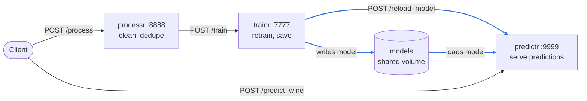

# Wine Cultivar Classifier: ML Microservices with Docker Compose

Three FastAPI microservices that preprocess data, train a model and serve predictions. They run together with Docker Compose and pass work to each other over HTTP. The model predicts which of three cultivars (grape growers) a wine came from, using the 13 chemical measurements in the [UCI Wine dataset](https://archive.ics.uci.edu/dataset/109/wine).

Started from the [PGCSEDS-IIITH/compose-iris](https://github.com/PGCSEDS-IIITH/compose-iris) course template (IIIT Hyderabad), which used the Iris dataset.

## Architecture


The highlighted edges are the model hand-off: trainr saves each new model to the shared volume and tells predictr to reload it, so predictions switch to the new model without a restart.

| Service | Port | What it does |
|---|---|---|
| **processr** | 8888 | Validates labelled samples, drops duplicates and forwards them to trainr. |
| **trainr** | 7777 | Trains a baseline model on startup. On `/train`, adds the new samples to the stored feedback, retrains on the base dataset plus all feedback, saves the model and tells predictr to reload it. |
| **predictr** | 9999 | Serves predictions from the latest saved model. |

- **Model:** `StandardScaler` + `LogisticRegression` (scikit-learn), about 98% 5-fold cross-validated accuracy.
- **Validation:** shared Pydantic schemas in `common/wine.py`. All 13 features must be present and non-negative, and class labels must be one of `Cultivar 1`, `Cultivar 2` or `Cultivar 3`.
- **Errors:** if a downstream service is unreachable, the caller gets a `502`. If predictr has no trained model yet, it returns a `503`.
- **Containers:** Python 3.11 slim images, running as a non-root user.

## Run it

```bash
docker compose up --build
```

Interactive API docs are served at http://localhost:8888, http://localhost:7777 and http://localhost:9999.

Get a prediction:

```bash
curl -s localhost:9999/predict_wine -H 'content-type: application/json' -d '{"alcohol":13.2,"malic_acid":1.78,"ash":2.14,"alcalinity_of_ash":11.2,"magnesium":100,"total_phenols":2.65,"flavanoids":2.76,"nonflavanoid_phenols":0.26,"proanthocyanins":1.28,"color_intensity":4.38,"hue":1.05,"od280_od315_of_diluted_wines":3.4,"proline":1050}'
```

Send labelled feedback through the whole pipeline with a `POST` to `localhost:8888/process`. The body is a JSON list of the same objects, each with an extra `"wine_class"` field.

## Tests

```bash
pip install -r trainr/requirements.txt -r requirements-dev.txt
pytest --cov=common --cov=processr --cov=trainr --cov=predictr
```

There are 11 tests, with 98% coverage. GitHub Actions runs them on every push, then builds the Compose stack and checks it end to end with real requests.
