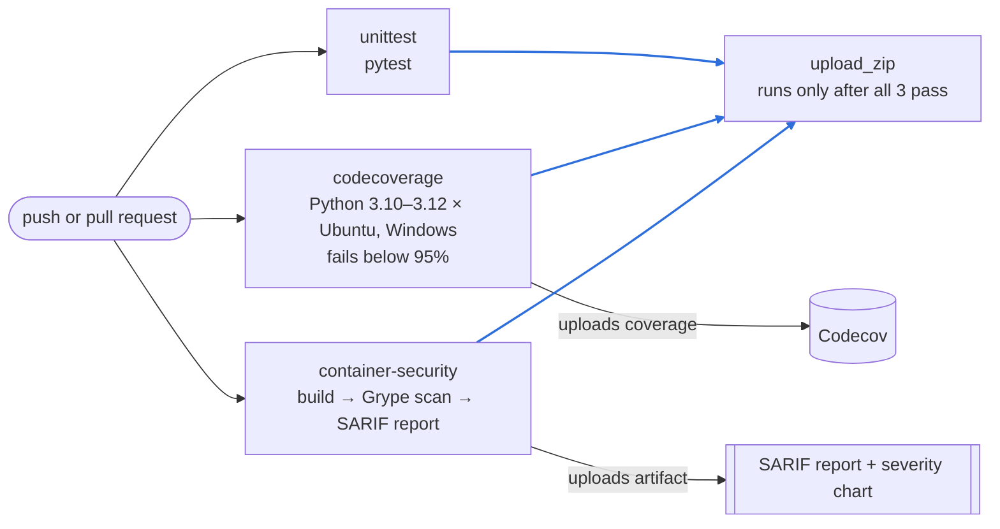
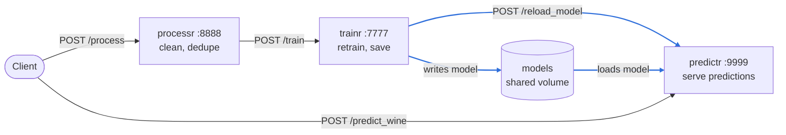

# Project Portfolio: Praveen Patnaik

Four projects from 2021, built during the **PGCSEDS program at IIIT Hyderabad**. They go from training ML models to serving them as APIs, splitting them into containers, and running automated tests, coverage checks and security scans before release.

| # | Project | Theme | Period | Key tech |
|---|---|---|---|---|
| 1 | [DevSecOps Pipeline for an ML API](#1-devsecops-pipeline-for-an-ml-inference-api) | DevSecOps, CI/CD | Sep 2021, updated 2026 | GitHub Actions, Docker, Anchore, SARIF, Codecov |
| 2 | [Containerized ML Microservices](#2-containerized-ml-microservices-with-docker-compose) | Microservices, Docker | Aug 2021, updated 2026 | Docker Compose, FastAPI, scikit-learn, pytest, GitHub Actions |
| 3 | [MLOps: Iris Prediction API](#3-mlops-iris-prediction-api-with-ci) | MLOps, CI | Jul 2021, updated 2026 | FastAPI, scikit-learn, pytest, GitHub Actions |
| 4 | [House Price Prediction Hackathon](#4-house-price-prediction-hackathon) | Data science, Big data | Sep 2021, updated 2026 | pandas, scikit-learn, Lasso/Ridge, PCA, PySpark MLlib |

> **Note:** Projects 1–3 are course assignments. Each one starts from a template repo provided by the course, and Praveen forked it and extended it. All four repos were updated in 2026 with fixes, tests and documentation. The sections below describe each repo as it is now, compared with the original template.

### Skills across the projects
- **ML engineering:** model training and evaluation, serving models over REST, online retraining (a feedback loop)
- **MLOps / DevOps:** GitHub Actions (matrix builds, job dependencies, artifacts), Docker, Docker Compose, shared volumes for models
- **DevSecOps:** container vulnerability scanning (Anchore/Grype), SARIF reports, Dependabot
- **Quality:** pytest, FastAPI TestClient, pytest-cov, Codecov
- **Data science:** exploratory data analysis (EDA), correlation analysis, handling missing values, one-hot encoding, PCA, regression, cross-validated RMSE
- **Big data:** PySpark DataFrames, VectorAssembler, Spark MLlib regression
- **Languages and libraries:** Python, FastAPI, Pydantic, Uvicorn, pandas, NumPy, scikit-learn, matplotlib, seaborn

---

## 1. DevSecOps Pipeline for an ML Inference API
**Repo:** https://github.com/Bpraveenpatnaik/devsecops-iris · **Period:** Sep 2021 · **Type:** Course assignment (forked template)

### Summary
Built out a GitHub Actions CI/CD pipeline that tests a containerized FastAPI machine-learning service, measures its code coverage, scans it for security issues and packages it for release. The tests run on 3 Python versions and 2 operating systems.

### Context
A hands-on "shift-left security" assignment: run tests, coverage tracking and container vulnerability scanning automatically on every push, before anything is released. The starter repo had a FastAPI service with a scikit-learn Gaussian Naive Bayes model for the Iris dataset (`/ping`, `/predict_flower`, `/feedback_loop`), a Dockerfile and a basic pipeline.

### What was built on top of the template
| Area | Contribution |
|---|---|
| Cross-platform CI matrix | Extended the coverage job to a **Python × OS matrix** (3 Python versions × Ubuntu and Windows), so every push runs **6 parallel jobs**. |
| Code coverage | Connected his fork to **Codecov** (`pytest-cov` plus `codecov-action`) and added the repo's coverage badge to the README. |
| Container security | Ran the **Anchore/Grype** scan of the Docker image built in CI, with a medium-severity cutoff, and saved the **SARIF** report as a build artifact. |
| Reporting | Committed the SARIF report and reviewed it in Microsoft's SARIF Web Validator. Later added `reports/sarif_summary.py`, which turns the report into a severity table and chart; CI now publishes these with every scan. |
| Testing | Tests for all three species, the feedback loop, model accuracy and input validation: **98% coverage**, with CI failing below 95%. |
| Hardening | The image moved to `python:3.11-slim`, runs as a non-root user, and copies in only the app code. The feedback loop now keeps the original training data instead of replacing it. |

### Pipeline

The three checks run in parallel; the highlighted edges are the release gate.

### Security findings
The scan found **72 vulnerabilities** in the `python:3.8-slim` image:

| Severity | Count | Notable |
|---|---|---|
| Critical | 2 | CVE-2021-33574 (glibc) |
| Medium | 6 | CVE-2021-37750 (Kerberos), CVE-2021-40528 (libgcrypt), CVE-2011-3389 (GnuTLS) |
| Low | 6 | n/a |
| Negligible | 58 | n/a |

**Insight:** every finding came from the Debian base image, not the application code, and none had an upstream fix when the scan ran. Ways to reduce the risk: rebuild on a newer base image regularly, use distroless or slimmer images, and remove unneeded layers.

### Resume bullets
- Extended a GitHub Actions CI/CD pipeline for a containerized FastAPI ML service to a cross-platform matrix (3 Python versions × Ubuntu/Windows, 6 parallel jobs), with a 95% coverage gate (98% achieved) and Codecov reporting.
- Added container vulnerability scanning with Anchore/Grype, automated a SARIF-to-chart severity report, and triaged 72 base-image CVEs (2 critical, 6 medium). Reduced the exposure with a newer slim base image and a non-root user.
- Set up gated release packaging, so artifacts are only published after the tests, coverage job and security scan all pass.

---

## 2. Containerized ML Microservices with Docker Compose
**Repo:** https://github.com/Bpraveenpatnaik/compose-iris · **Period:** Aug 2021 · **Type:** Course assignment (forked template)

### Summary
An ML system split into three containerized FastAPI microservices: **preprocessing → training → prediction**. They run together under Docker Compose, talk to each other over HTTP and share trained models through a named volume. The template used the Iris dataset; this version predicts the **cultivar of a wine from all 13 chemical measurements in the UCI Wine dataset**, with a scaled **logistic regression** model (about 98% cross-validated accuracy).

### Architecture

The highlighted edges are the model hand-off: trainr saves each new model to the shared volume and tells predictr to reload it, so predictions switch to the new model without a restart.
- **processr:** validates and cleans incoming labelled records, then forwards them to `trainr`.
- **trainr:** loads the current model from the shared volume, retrains it, saves it, and tells `predictr` to reload.
- **predictr:** serves predictions from the latest saved model.
- Services find each other through environment variables (`TRAINR_ENDPOINT`, `PREDICTR_ENDPOINT`) and can be scaled with `deploy.replicas`.

### What was built on top of the template
- **New dataset:** moved all three services from Iris to the **UCI Wine dataset**, using all 13 features and the correct cultivar labels, with a `/predict_wine` endpoint.
- **Shared schemas:** a single Pydantic module (`common/wine.py`) used by every service. It rejects negative values and unknown class labels.
- **Better retraining:** feedback is stored and the model is retrained on the base data plus all feedback. The template refit on only the newest batch, which threw away earlier learning.
- **Better model:** `StandardScaler` + logistic regression, reporting 5-fold cross-validated accuracy after each retrain.
- **Reliability:** trainr trains a baseline model on startup. Services return a clear `502` or `503` when a downstream service or the model is unavailable, and requests have timeouts.
- **Containers:** Python 3.11 slim images that run as a non-root user, a named volume for models, and no model files committed to git.
- **Testing and CI:** 11 pytest tests (98% coverage), and a GitHub Actions pipeline that runs them, then builds the Compose stack and checks it end to end with real HTTP requests.

### Resume bullets
- Built a 3-service ML system (preprocess → train → predict) on Docker Compose. The services communicate over REST and share models through a named volume, so retrained models go live without downtime.
- Designed an online-retraining loop that keeps all past feedback and reports cross-validated accuracy (about 98%) after each update.
- Added a pytest suite (98% coverage) and a GitHub Actions pipeline that builds the Compose stack and tests it end to end.

---

## 3. MLOps: Iris Prediction API with CI
**Repo:** https://github.com/Bpraveenpatnaik/mlops-iris · **Period:** Jul 2021 · **Type:** Course assignment (forked template)

### Summary
A FastAPI service that serves an Iris flower classifier. On startup it trains two models and **serves whichever has the best cross-validated accuracy**. Each response includes the model used and a UTC timestamp. GitHub Actions runs the tests with a coverage gate and packages each release.

### What was built on top of the template
- **Model selection:** Gaussian Naive Bayes and a Decision Tree are each scored with 5-fold cross-validation on the training split. The better one is served, and its accuracy on a held-out test split is logged (Naive Bayes wins: 95.8% CV, 96.7% on the test split).
- **Traceable predictions:** responses include `flower_class`, `model` and `timestamp`.
- **Feedback loop:** labelled samples are added to the training data, so retraining never forgets earlier data.
- **Validation:** measurements must be positive, and class labels are checked against the three species.
- **Tests and CI:** 8 pytest tests (99% coverage) covering each species, model selection, timestamps, feedback and validation. CI fails if coverage drops below 90%, and a gated release job zips the code.

### Resume bullets
- Built a FastAPI ML inference service that picks the best of several classifiers by cross-validated accuracy at startup and returns traceable predictions (model name and timestamp).
- Implemented an online-retraining feedback loop and a pytest suite with 99% coverage, run in GitHub Actions with a coverage gate and gated release packaging.

---

## 4. House Price Prediction Hackathon
**Repo:** https://github.com/Bpraveenpatnaik/IIITH-Hackathon-2 · **Period:** Sep 2021 · **Type:** Hackathon (IIIT Hyderabad), individual work

### Summary
A full regression workflow for predicting house sale prices on the Ames housing dataset (the data used in Kaggle's "House Prices" competition). It covers EDA, feature cleaning, a comparison of scikit-learn models, and a **PySpark MLlib** version of the pipeline. Originally a Colab notebook, it is now a set of runnable scripts with reported results.

### Approach
1. **EDA:** the target is skewed to the right, so models are trained on log(price). A correlation heatmap picks out the top 10 features (overall quality 0.79, living area 0.71, garage size), and a table shows the missing values.
2. **Data cleaning:** dropped the 7 columns missing in more than 15% of rows (e.g. `PoolQC`, `Alley`, `Fence`). Filled other gaps with the median or most frequent value, then one-hot encoded and scaled, all inside a scikit-learn `Pipeline` so nothing leaks between training and test data.
3. **Model comparison (5-fold CV):**

   | Model | CV RMSE (log price) | Test RMSE ($) | Test R² |
   |---|---|---|---|
   | **Lasso** | **0.130** | **23,621** | **0.927** |
   | Ridge | 0.135 | 25,480 | 0.915 |
   | Random forest | 0.144 | 29,120 | 0.889 |
   | PCA (5) + linear | 0.148 | 31,467 | 0.871 |
   | Plain linear regression | unstable | n/a | n/a |

4. **Big-data pipeline (PySpark):** `Imputer` → `VectorAssembler` → `StandardScaler` → elastic-net regression in a Spark ML `Pipeline`, with the target kept out of the features. Test RMSE was $33,198 and R² 0.887 (log scale), using only the 36 numeric features.

**Key insight:** after one-hot encoding there are about 270 correlated columns. Plain linear regression becomes numerically unstable, while regularized models (Lasso, Ridge) stay stable and win.

### Resume bullets
- Built a house-price regression pipeline (EDA, handling missing data, one-hot encoding, a log-transformed target) in a leak-free scikit-learn pipeline. Lasso reached R² 0.927 (about $23.6k RMSE) across 5 compared models.
- Rebuilt the pipeline in PySpark MLlib (Imputer, VectorAssembler, elastic-net regression) to show it could scale, and found that regularization was essential on the high-dimensional one-hot features.

---

## Links
- GitHub profile: https://github.com/Bpraveenpatnaik
- DevSecOps pipeline: https://github.com/Bpraveenpatnaik/devsecops-iris
- Docker microservices: https://github.com/Bpraveenpatnaik/compose-iris
- MLOps API: https://github.com/Bpraveenpatnaik/mlops-iris
- Hackathon: https://github.com/Bpraveenpatnaik/IIITH-Hackathon-2
